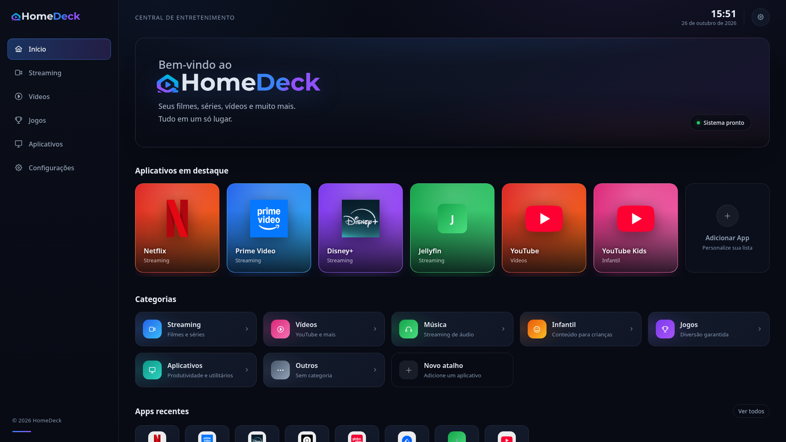
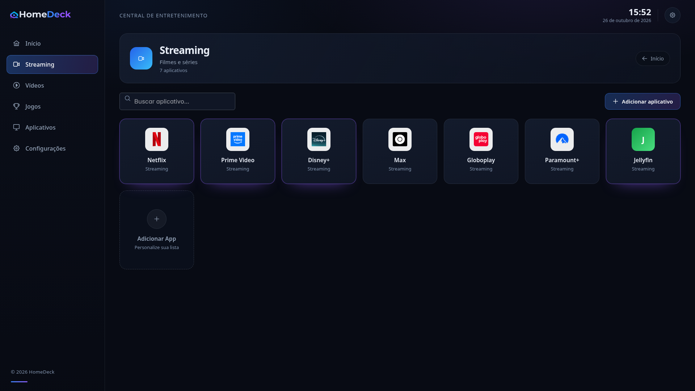

# HomeDeck

Central de entretenimento para TV e PC: um painel escuro onde você cadastra atalhos de streaming, vídeos, música e jogos, e abre tudo num clique. Sem backend, sem login, sem dependência de servidor de aplicação — os dados ficam no `localStorage` do próprio dispositivo.



## O que dá pra fazer

- Criar, editar, destacar e excluir atalhos (nome, URL, categoria, ícone, cor, descrição).
- Criar categorias dinamicamente. Nada de tela nova por categoria: existe uma única página, `CategoryPage`, que resolve `/c/:categoryId` a partir dos dados salvos. O menu lateral também é gerado a partir da configuração de categorias.
- Buscar dentro de uma categoria, ver os recentes na home e abrir o app em nova aba.
- Exportar e importar backup em JSON, e restaurar o padrão de fábrica.
- Categorias padrão já vêm populadas: Streaming, Vídeos, Música, Infantil, Jogos, Aplicativos, Outros.

## Stack

React 19 com React Compiler, Vite 8, React Router 7 (data router), PrimeReact 10 + PrimeIcons + PrimeFlex, CSS próprio para a identidade do HomeDeck. ESLint flat config com `eslint-plugin-react-hooks` 7, que pega as regras novas do React Compiler.

## Arquitetura

```
src/
  config/      categorias e paleta: fonte única de configuração
  services/    storage (localStorage + seed + backup), url, appActions
  providers/   Toast, Dialog, Confirm, Loading, Data + useAppActions
  layouts/     MainLayout (sidebar dinâmica, clock, header)
  pages/       Home, CategoryPage, Settings, NotFound
  components/  AppCard, AppIcon, CategoryCard, AppForm, CategoryForm, EmptyState
  styles/      global.css (design tokens + TV scaling)
```

Alguns pontos que valem a pena olhar:

- **`providers/DialogProvider.jsx`** — sistema de dialog programático. `useDialog().open()` recebe título, conteúdo (incluindo formulário), botão primário assíncrono e devolve o resultado da operação por promise. Tem estado de loading, bloqueio de submit duplo, e em caso de erro o dialog fica aberto pra você corrigir e tentar de novo. O form registra o handler de submit via `setSubmitHandler`, então o botão do footer realmente dispara o `requestSubmit()` do formulário.
- **`providers/useAppActions.js`** — toda a lógica de negócio (add/edit/remove app e categoria, destacar, toasts) mora num lugar só. As páginas só chamam; nenhuma duplica regra.
- **`services/storage.js`** — chaves versionadas (`homedeck.apps.v1`), seed de primeira execução, e importação com validação: entrada malformada é descartada e `categoryId` desconhecido cai em `Outros` em vez de quebrar a UI.
- **`services/url.js`** — normaliza endereço (aceita sem `https://`), bloqueia esquema que não seja http(s), e libera `http` só para host local (localhost, `.local`, `10.x`, `192.168.x`, `172.16–31.x`) — porque Jellyfin na LAN é o caso de uso real.

## TV first

O layout foi verificado em 1920×1080 e escala com o viewport: `font-size` raiz em 17px a partir de 1700px e 20px a partir de 2200px, com a sidebar acompanhando. Cards usam `aspect-ratio` + `object-fit: cover`, ícone nenhum estica. Contraste do texto secundário foi ajustado pro consumo a 3 metros de distância.



## Rodando

```bash
npm install
npm run dev
npm run build && npm run preview
```

Deploy é estático: sirva `dist/` no Nginx com `try_files $uri /index.html;` para que os deep links (`/c/streaming`, `/settings`) funcionem no refresh.

## Nota de design

O visual segue um mockup de referência fixo — composição, hierarquia, espaçamento e clima foram reproduzidos, sem reinventar a direção. A marca vem de `public/h_main_brand.png` e o recorte do slogan embutido na imagem é feito em CSS com `aspect-ratio` + `object-fit`, sem distorcer o arquivo.
